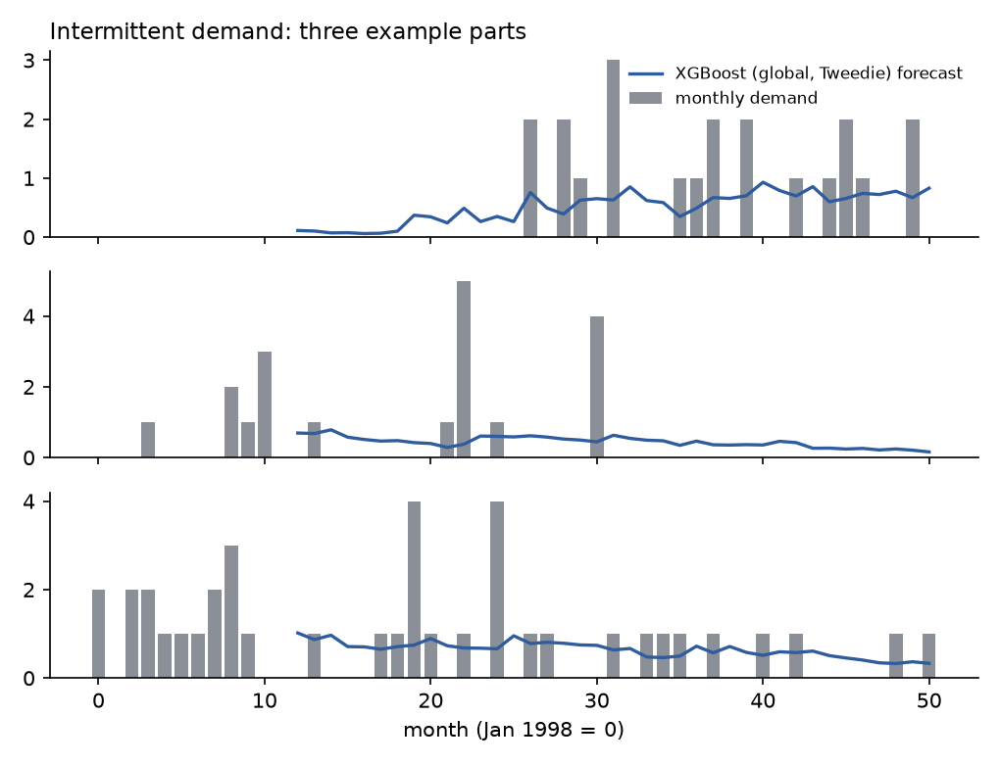
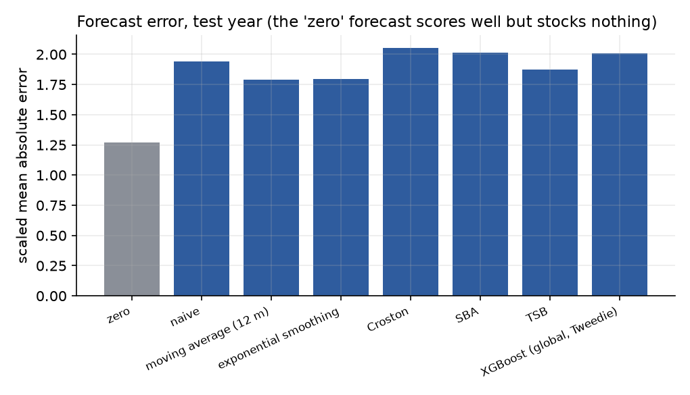
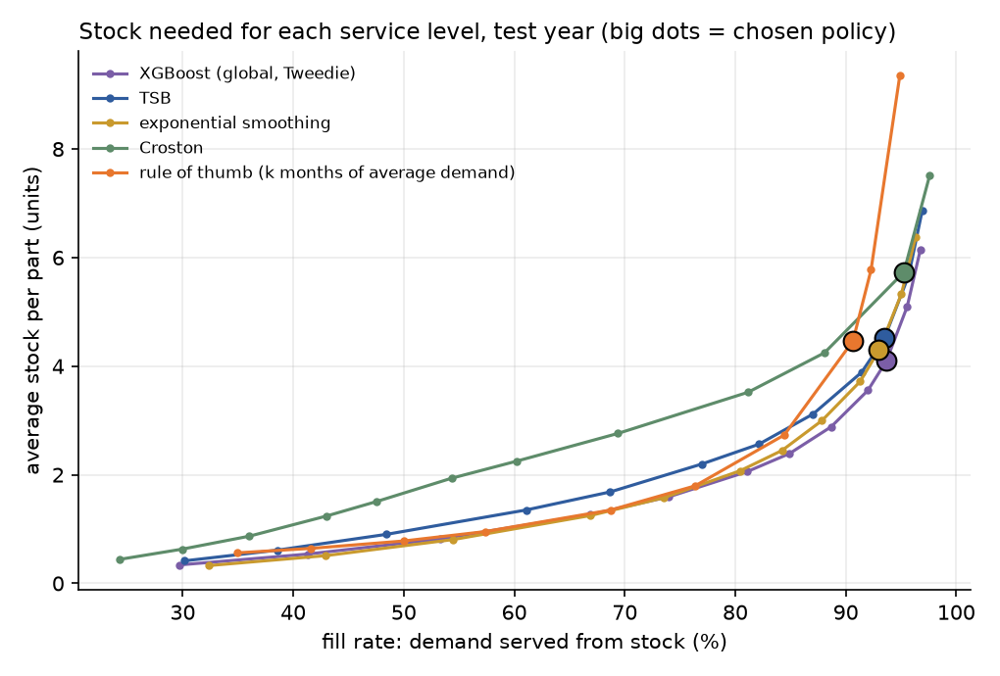

# Spare Parts: Demand Forecasting and Inventory Optimisation

[](https://github.com/Sumant-crty/spare-parts-inventory/actions/workflows/ci.yml)

How much of each spare part should a business keep? This project forecasts demand for **2,509 car spare parts**, sets reorder levels and safety stock for each, and **simulates a year of inventory** to compare policies on what matters: how often customers get their part, how much stock it takes, and what it costs. A FastAPI service gives order quantities for any part.

Data: monthly sales of car parts from January 1998 to March 2002 (Hyndman's `carparts` data, from the [Monash Time Series Forecasting Repository](https://zenodo.org/records/4656022), CC BY 4.0).

## At a glance

| | |
|---|---|
| **Business problem** | How much of each of 2,509 car spare parts to keep in stock. Too much ties up cash; too little leaves cars off the road; and demand is mostly zero. |
| **Baseline** | A rule of thumb: keep *k* months of average demand, with *k* (9 months) chosen on the previous year. |
| **Result** | In simulation, a policy driven by a global XGBoost forecast costs **21.5% less** (95% CI 18.7–24.6%) with a **higher fill rate** (93.7% against 90.6%), and needs 26% less stock for a 90% fill rate. |
| **How it was evaluated** | One-month-ahead forecasts from past data only. Each policy's service target was chosen on April 2000 – March 2001 and then applied unchanged to April 2001 – March 2002. |
| **Business impact** | **Simulation estimate, not measured savings.** Real demand history replayed through an inventory simulation, with *assumed* costs (holding 25% a year, backorders 100% of part value per month) and an assumed 1-month lead time. |

## The problem: demand that is mostly zero



71% of part-months have no sales; a typical part sells once every 4.6 months, a few units at a time. 2,187 parts are **intermittent** (occasional demand of similar size) and 287 are **lumpy** (occasional and erratic in size). Total demand also halved over the four years as parts became obsolete. Standard forecasting and stocking rules handle this badly.

## Approach

1. **Forecasting methods** (one month ahead, using only past data):
   - simple: naive, 12-month moving average, exponential smoothing
   - built for intermittent demand: **Croston**, **SBA** (bias-corrected Croston) and **TSB** (which also adapts when a part stops selling)
   - a **global XGBoost model** trained across all parts, with a Tweedie loss suited to many zeros
   - an empirical method that uses past demand totals directly
2. **Inventory policy:** review every month, lead time 1 month, order up to a level *S* that covers demand over the next 2 months at a target service level. Demand is modelled as negative binomial (Poisson when demand is not over-dispersed), with variance from each method's recent forecast errors.
3. **Simulation:** every part, every month of the test year (April 2001 – March 2002): order, receive, serve demand, record stock and backorders.
4. **Choosing the service level:** for each method, the cost-minimising service target was chosen on the previous year (April 2000 – March 2001) and then applied unchanged to the test year.
5. **Costs** are assumptions, stated relative to a part's value: holding stock costs 25% a year (2.1% a month), and each unit backordered for a month costs 100% of its value (a car off the road). A sensitivity analysis varies the backorder cost.

The benchmark is a common **rule of thumb**: keep *k* months of average demand, with *k* also chosen on the previous year (it chose 9 months).

## Results

### Forecast error is the wrong scorecard



Forecasting **zero every month** has the lowest error of all (scaled MAE 1.27 against 1.79 or more for every real method), yet it would never stock anything. The global XGBoost model has one of the *higher* errors (2.01) but, as the next table shows, the best stocking results. For intermittent demand, methods have to be judged by the inventory they produce.

### Inventory outcomes on the test year

| Policy | Service target | Fill rate | Average stock per part | Cost per part-month |
|---|---|---|---|---|
| **XGBoost (global)** | 98% | **93.7%** | **4.10** | **0.123** |
| Exponential smoothing | 98% | 93.0% | 4.30 | 0.132 |
| TSB | 98% | 93.5% | 4.51 | 0.134 |
| Empirical (past 24 months) | 97% | 89.1% | 3.58 | 0.141 |
| Croston | 99% | 95.3% | 5.73 | 0.149 |
| Rule of thumb (9 months of cover) | – | 90.6% | 4.46 | 0.156 |

*Fill rate is the share of demand served straight from stock. Cost is in units of part value.*

- **XGBoost against the rule of thumb:** 3.1 points higher fill rate with 8% less stock, and **21.5% lower cost** (95% CI 18.7–24.6%).
- **For a 90% fill rate**, XGBoost needs **3.2 units** of stock per part, TSB 3.6, the rule of thumb 4.3 and Croston 4.6, so XGBoost needs **26% less stock than the rule**.
- **XGBoost against the next-best methods:** 7.3% lower cost than exponential smoothing (CI 5.7–9.1%) and 8.2% lower than TSB (CI 6.3–10.4%).
- **Croston and SBA, the textbook methods for intermittent demand, were worse** than simple smoothing here: 17.5% higher cost than XGBoost. With demand declining, they keep forecasting a part's old rate long after it fades, so they hold more stock for the same service.



The rule of thumb's stock climbs steeply beyond about 85% fill rate: adding months of cover buys little extra service for slow movers.

### How much a stockout costs changes the answer

Re-choosing every policy on the previous year for each assumed backorder cost:

| Backorder cost (share of part value per unit-month) | XGBoost fill rate / stock | Rule of thumb fill rate / stock | Cost saving |
|---|---|---|---|
| 0.25 | 81.1% / 2.06 | 76.4% / 1.80 | 5.7% |
| 1 | 93.7% / 4.10 | 90.6% / 4.46 | 21.5% |
| 4 | 96.8% / 6.15 | 94.9% / 9.35 | 40.2% |

The more a stockout costs, the more a forecast-based policy saves: at high backorder costs the rule of thumb needs 50% more stock and still serves less demand.

## Prediction service

```bash
uvicorn api.main:app        # http://localhost:8000/docs
```

| Endpoint | Purpose |
|---|---|
| `GET /parts/{id}?on_hand=&on_order=` | Forecast, order-up-to level, safety stock and **order quantity** for April 2002 |
| `POST /reorder` | The same advice for any part from its monthly demand history (parts with under 13 months use TSB) |
| `GET /model` | Method, service level and test-year results |

From the running service, for the busiest part:

```json
{"part": "T2475", "pattern": "lumpy", "forecast_per_month": 1.346, "order_up_to_level": 33,
 "safety_stock": 30.31, "inventory_position": 6.0, "order_quantity": 27}
```

The deployed model is retrained on all four years. Its errors on that history are in-sample and slightly optimistic, so the error variance is scaled by the measured ratio of out-of-sample to in-sample error (1.05). A test confirms the history endpoint reproduces the precomputed advice exactly.

## Run it

```bash
pip install -r requirements-dev.txt
export PYTHONPATH=src:.
python scripts/download_data.py   # from Zenodo, no login needed
python -m spareparts.train        # about 20 seconds
pytest -q                         # 12 tests
uvicorn api.main:app
docker build -t spareparts . && docker run -p 8000:8000 spareparts
```

## Limitations

- **Costs and lead time are assumptions.** The data has no prices, lead times or ordering costs; with real values, set the service target per part from its own costs (for example, higher targets for critical or cheap parts).
- **One year of testing.** The confidence intervals resample parts within that year, not different years.
- **Parts that stop being reported** (165 series end early) are excluded, and with them some of the obsolescence the business would face.
- **The global model's early warm-up months** are partly in-sample when estimating forecast-error variance for the validation year.

See the [model card](MODEL_CARD.md) for intended use and risks.

## Author

**Sumant Chakravarty** · [LinkedIn](https://www.linkedin.com/in/sumant-chakravarty-b117b539/)
